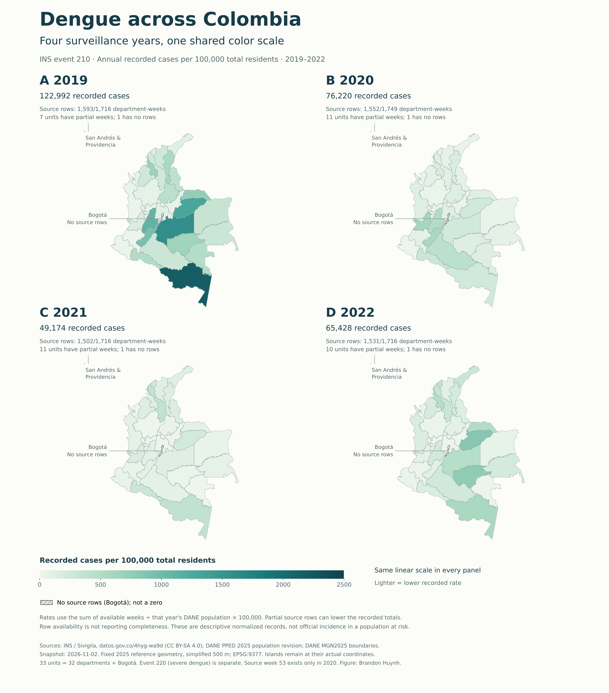
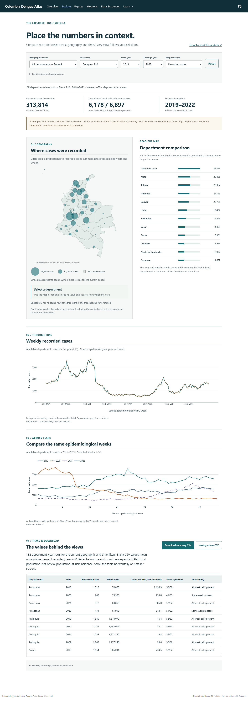
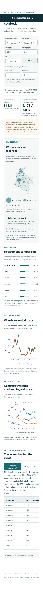

# Colombia Dengue Surveillance Atlas

**Brandon Huynh** · A reproducible atlas of reported dengue surveillance observations
in Colombia, 2019–2022.

Repository: [TheThunda01/colombia-dengue-atlas](https://github.com/TheThunda01/colombia-dengue-atlas)
· Live website:
[Colombia Dengue Surveillance Atlas](https://thethunda01.github.io/colombia-dengue-atlas/).
Updated for **v1.1.0** on 2 November 2026. Read the [visual and guide update](reports/visual-guide-review-2026-11-02.md)
and the preserved [first-release report](RELEASE_REPORT.md) for verification scope.

## Why this project

Reported case counts describe a surveillance system as well as a disease. This
atlas helps researchers, students, and public health readers compare Colombian
departments while seeing the source, geographic definitions, missing observations,
and population denominator behind each view.

Start with the [question and reasoning](docs/project-context.md), then the
[dengue and surveillance concepts](docs/biology-and-concepts.md). The
[annotated build guide](docs/build-guide.md) follows one value from source to screen.

Within [From biological measurements to better experiments](https://github.com/TheThunda01/TheThunda01/blob/main/PROJECT_GUIDE.md),
this project demonstrates spatial data preparation and evidence-aware scientific
visualization. It is a separate surveillance workflow, not an integrated pipeline
with the portfolio's molecular or experimental projects.

## What it does

- Coordinates geographic, year, epidemiological-week, event, and metric selections
  across a department map, weekly series, seasonal comparison, and summary table.
- Keeps INS event **210 (dengue)** and **220 (severe dengue)** separate, with an
  explicit reset and visible selection summary.
- Shows source-row availability and distinguishes missing cells from reported
  zeros; Bogotá remains selectable even though it has no selected-event records.
- Downloads the current summary with identifiers, units, source metadata, and
  denominator information. Available normalization is **reported cases per
  100,000 total population**, not official incidence per population at risk.
- Adds a four-year map plate with one shared color scale, editable SVG,
  Inkscape PNG/PDF exports, and a complete 132-row companion table.
- Runs entirely as a static Quarto website. Python prepares aggregates and publication
  figures; browser JavaScript supplies linked interactions without a
  running Python service or paid map provider.

The source is INS's licensed aggregate dataset `4hyg-wa9d`, using 2019–2022;
DANE supplies 132 department-year population values and 33 reference map units
(32 departments plus Bogotá D.C.). PAHO was investigated and documented but its
observations are not mixed into this release.

## Quick start

Install **Python 3.12**, **uv 0.11.15**, **Quarto 1.9.37**, and **Node.js 24**. The Python dependency
versions are locked in `uv.lock`; use the project environment for every command.
From the repository root:

```powershell
uv sync --frozen --system-certs
uv run python scripts/build.py
uv run python scripts/site.py preview
```

The build writes `site/_site/index.html`, supporting assets, and the weekly figure.
It verifies and reuses the committed `figures/map-comparison.svg`, PNG, and PDF
against their recorded input, renderer, and output fingerprints. Inkscape is
needed only when refreshing that artwork; see the [free software guide](docs/visualization-tools.md). The preview
command serves http://127.0.0.1:4200/. Use that server for browser interactions;
opening the HTML directly with a `file:` URL can prevent data loading.

To recalculate processed data from pinned original inputs:

```powershell
uv run python scripts/prepare_geography.py --download
uv run python scripts/build.py --prepare
```

The first command downloads missing DANE inputs and rejects changed source
fingerprints; it never silently replaces an existing snapshot. See
[source retrieval and refresh](docs/sources.md) before adopting newer data.

## Example results

The licensed INS snapshot contains **57,083 municipal week/event aggregate rows**.
After excluding foreign and unknown origin from the department map, the sums of
published dengue event-210 observations are **122,992 (2019), 76,220 (2020),
49,174 (2021), and 65,428 (2022)**. These are snapshot-specific sums, not estimates
of all infections or proof that every municipality reported.



[Download the editable SVG](figures/map-comparison.svg) · [Vector PDF](figures/map-comparison.pdf) ·
[132 department-year values](data/processed/map_comparison.csv)



<details>
<summary>Narrow-screen view</summary>



</details>

Inspect the reproducible [vector figure](figures/weekly-comparison.svg) or its
[PNG export](figures/weekly-comparison.png), the
[weekly surveillance table](data/processed/surveillance_weekly.csv), and the
[DANE population table](data/processed/population.csv). Figure exports and browser
views describe the same pinned input release.

## Practical use and limitations

Choose an event, department, and comparable set of source weeks; inspect the
availability counts before comparing years. Download the table to preserve the
selection and its interpretation. Occurrence/procedence geography is not
necessarily residence, and the API does not establish whether weeks derive from
notification or symptom onset. The atlas preserves the source week labels,
including week 53 in 2020, rather than relabeling them as calendar dates.

All four years have elapsed, but surveillance capture is not established as complete and is subject
to revisions. Absent rows remain missing. The mapped department sums exclude
foreign and unknown procedence, which remain in the audit. Fixed MGN2025 display
boundaries are not a reconstruction of historical boundaries. The atlas supports
descriptive comparison and source inspection; it does not estimate causal
effects, forecast outbreaks, or determine individual clinical risk.

Three decisions worth being able to explain:

1. **Absence is not zero.** The sparse source has no explicit zero rows. Filling
   its absent cells with zeros would manufacture observations and conceal the
   distinction between an observed count and unavailable data.
2. **The denominator changes the question.** Dividing by DANE total population
   permits a population-normalized descriptive comparison. It does not reproduce
   INS incidence based on the population at risk, and occurrence-based counts
   do not establish resident infection risk. Districts must be included exactly
   once in their parent department before that division.
3. **A static release can remain interactive and reproducible.** Pinned original
   responses and checked Python transformations produce small browser assets.
   Shared JavaScript calculations make charts and CSV downloads agree, while
   avoiding a live server and uncontrolled source changes during viewing.

## Documentation

Read from the question toward the implementation, or jump to the stage you need.

| Reading order | Guide | What it helps you understand |
| --- | --- | --- |
| 1. Frame the question | [Project context and reasoning](docs/project-context.md) | Why these sources, these years, and these visual encodings. |
| 2. Learn the concepts | [Dengue and surveillance concepts](docs/biology-and-concepts.md) · [Glossary](docs/glossary.md) | Recorded cases, absent rows, denominators, and map terminology. |
| 3. Try an example | [Practical use](docs/practical-use.md) · [Live explorer](https://thethunda01.github.io/colombia-dengue-atlas/explore.html) | Follow a selection through the views and downloads. |
| 4. Inspect the calculation | [Methods](docs/methods.md) · [Data dictionary](docs/data-dictionary.md) · [Assumptions](docs/assumptions.md) | Exact definitions, formulas, units, and unresolved limitations. |
| 5. Follow the evidence | [Source register](docs/sources.md) · [INS](docs/ins-source.md) · [DANE](docs/dane-source.md) · [PAHO assessment](docs/paho-source-assessment.md) | Retrieval, versions, geographic rollups, and reuse terms. |
| 6. Build and adapt it | [Annotated build guide](docs/build-guide.md) · [Free software choices](docs/visualization-tools.md) · [Design notes](docs/design.md) | Commented code, reproducible commands, and when Blender or QGIS would help. |
| 7. Check the release | [v1.1 review](reports/visual-guide-review-2026-11-02.md) · [First release](RELEASE_REPORT.md) · [Correction log](docs/corrections-2026-11-02.md) | What was actually tested and what those checks establish. |

The [focused source review](docs/literature-review.md), [search log](docs/search-log.json),
[reference audit](docs/reference-audit.md), [geography validation](reports/geography_validation.json),
and [figure provenance](reports/cartographic_plate.json) preserve the deeper evidence.
[Data reuse terms](DATA_LICENSE.md) and [software citation](CITATION.cff) stay separate.

## Development and reuse

```powershell
uv run pytest
node --test tests/model.test.mjs
uv run python scripts/browser_checks.py --url https://thethunda01.github.io/colombia-dengue-atlas/
```

For local browser checks, replace the URL with the address printed by the preview
command. Install the browser-check runtime if needed with
`uv run playwright install chromium`, then pass `--channel chromium`. On Windows,
the default uses an installed Microsoft Edge browser (`--channel msedge`). The checks address data invariants,
filter/download agreement, and rendered interactions. Their success does not
establish complete case ascertainment or validate epidemiological interpretation.

Original code is [MIT licensed](LICENSE). INS-derived surveillance data retain
**CC BY-SA 4.0**; DANE population values and geometry have separate attribution
requirements described in [DATA_LICENSE.md](DATA_LICENSE.md). Do not apply the
code license to third-party data. Cite the software using [CITATION.cff](CITATION.cff)
and retain the underlying dataset citations. See [CONTRIBUTING.md](CONTRIBUTING.md)
for source-refresh and review expectations.
