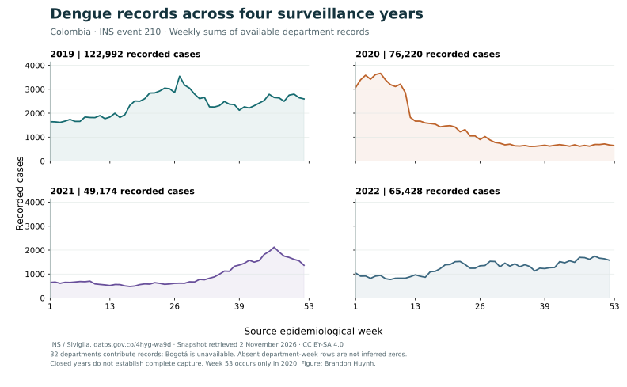

## Four maps, one scale

Compare annual dengue event-210 observations using the same population-normalized
color scale in every panel. The scale runs from zero to 2,500, rounded above the
largest available department-year value. Hatched geography has no usable value.

[Editable SVG](figures/map-comparison.svg) · [High-resolution PNG](figures/map-comparison.png) · [Vector PDF](figures/map-comparison.pdf) · [All 132 department-year values (CSV)](data/map_comparison.csv)

These are sums of available records divided by each year's DANE total population,
not official incidence per population at risk. Missing weeks are not replaced
with zeros. The CSV preserves their presence/absence counts for each department
and year. The figure's availability notes describe this extract, not complete
case ascertainment. The fixed MGN2025 map provides a common reference geography;
it is not a reconstruction of historical boundaries.

Python and GeoPandas prepare the values and geometry; Matplotlib creates editable
SVG artwork. Inkscape exports the release's PNG and PDF from that SVG. The
[build guide](build-guide.qmd) explains the code and the
[software guide](tools.qmd) explains that choice.

## The weekly comparison

[SVG](figures/weekly-comparison.svg) · [PNG](figures/weekly-comparison.png) · [PDF](figures/weekly-comparison.pdf) · [Weekly source panel (CSV)](data/surveillance_weekly.csv)

Each panel sums available department records. The explorer exposes the underlying
source-row availability and lets you focus on one department or selected weeks.
Both figures use the same pinned INS and DANE inputs. INS-derived values retain
CC BY-SA 4.0; preserve the source attribution and the
[data reuse terms](https://github.com/TheThunda01/colombia-dengue-atlas/blob/main/DATA_LICENSE.md)
when reusing an image or table.

[Open the explorer →](explore.qmd) · [Methods and interpretation](methods.qmd)
