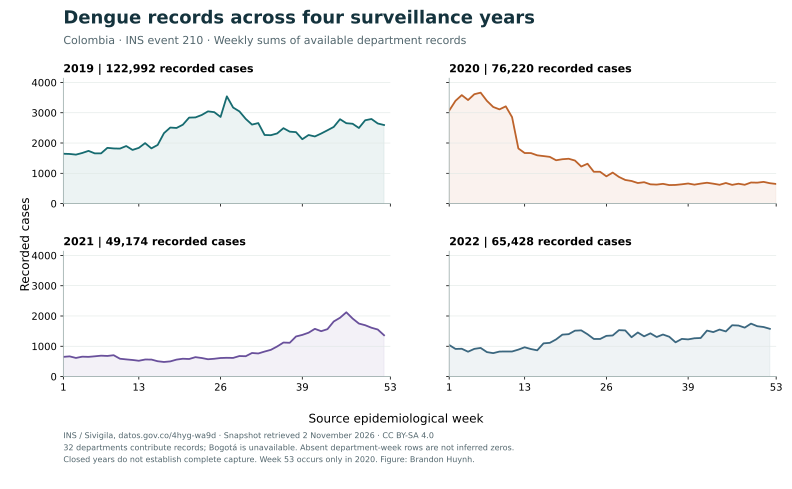

::: {.hero}
::: {.eyebrow}
OPEN SCIENCE / HISTORICAL SURVEILLANCE / 2019–2022
:::
# Colombia Dengue Surveillance Atlas

Explore where dengue cases were recorded, how counts changed across weeks, and what the available evidence can tell us.

[Explore the atlas →](explore.qmd){.hero-button} [Read the methods](methods.qmd){.text-link}

::: {.hero-note}
32 departments with recorded dengue data. Bogotá D.C. remains visible as unavailable. Built from public INS aggregates and DANE population estimates.
:::
:::

::: {.intro-grid}
::: {}
## Start with the record, then the pattern

A map can show geographic differences; it cannot, on its own, explain them. This atlas connects geographic comparisons to weekly source records, population denominators, and downloadable summaries.

The first release covers four closed surveillance years, **2019–2022**, from one pinned INS open-data snapshot. These are historical reported counts, not estimates of every infection or a forecast of current risk.
:::
::: {.editorial-note}
### Three rules for reading the atlas

1. **A gap is not a zero.** Absent source rows stay missing.
2. **A rate needs a denominator.** DANE total population differs from the population at risk used for official incidence.
3. **A surveillance record can change.** Revisions and case definitions matter when comparing sources.
:::
:::

## Four years, one transparent comparison

[Compare all four years on a shared map scale →](figures.qmd)

The figure sums available event 210 records across the 32 departments. It does not establish complete case capture. The interactive explorer exposes the source-row availability behind each selection.

[Download SVG](figures/weekly-comparison.svg) · [Download PNG](figures/weekly-comparison.png) · [Explore weekly values](explore.qmd)

::: {.intro-grid}
::: {}
## Reproducible from source to screen

Python prepares versioned aggregates, checks geographic identifiers, and joins annual population estimates. Quarto builds the website. All exploration then runs in your browser with the same local data used by the summary table.

[Sources, licenses, and data dictionary →](data.qmd)

[Follow the annotated build guide](build-guide.qmd) · [Compare free visualization tools](tools.qmd)
:::
::: {}
## A research demonstration

Created by **Brandon Huynh** to make spatial epidemiology and its assumptions inspectable. The project is suited to learning and descriptive research exploration. It is not a clinical tool or an operational alert system.

[Code, reproduction commands, and review evidence →](https://github.com/TheThunda01/colombia-dengue-atlas)
:::
:::
